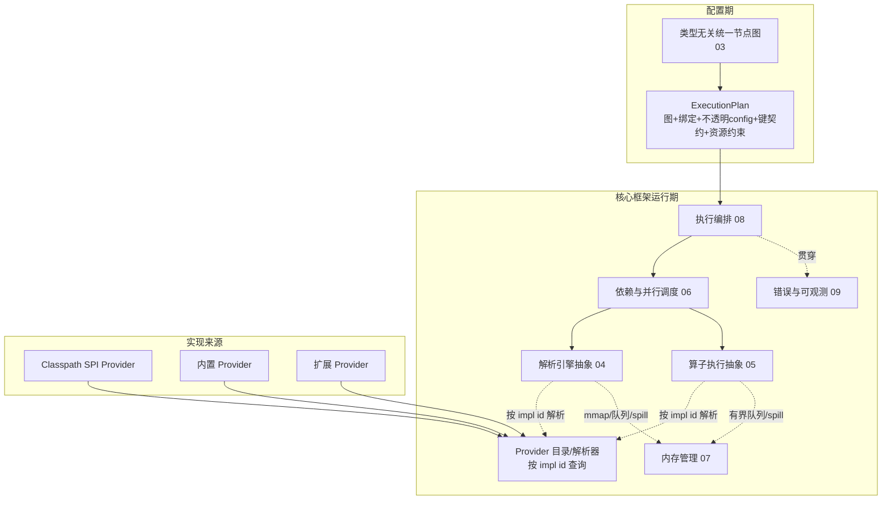
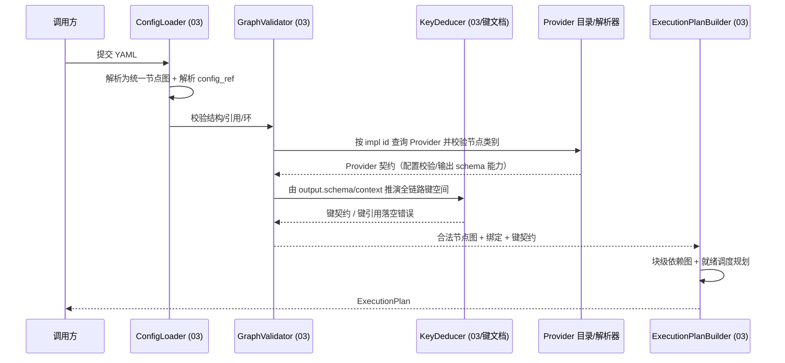
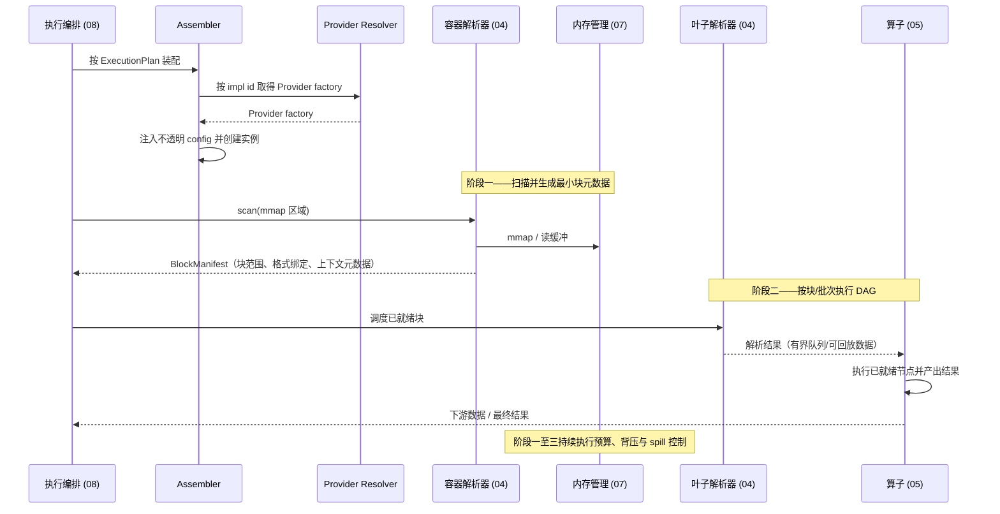

# 01 · 总体设计

> 所属项目：可配置化超大文件数据解析服务
> 文档类型：总体设计（统领全部模块详细设计）
> 本文聚焦：**方案目标、核心框架与内置实现的分层、模块全景与模块整体交互、端到端数据流概览**。
> 模块内部实现请参见对应模块文档；具体解析器/算子实现请参见 [11-内置解析器与算子实现.md](11-内置解析器与算子实现.md)。

---

## 1. 背景与目标

业务数据以本地半结构化文件形式存储，文件内部多种格式混布嵌套，需要按可配置规则解析为键值对（KV），并经过处理器链做格式转换与数据衍生后输出。文件规模极端情况下可达 80GB，传统全量加载解析会内存溢出（OOM），解析规则硬编码则维护成本极高。

| 目标 | 说明 |
| --- | --- |
| 解析目标 | 将半结构化文本文件解析为标准化 KV，文件路径亦作为一等数据源参与解析 |
| 时间复杂度 | 扫描与逐块解析主路径随输入规模线性增长；算子复杂度、数据膨胀与外部排序成本必须显式说明 |
| 内存可控 | 为进程管理内存设置可配置预算；队列、索引、算子状态和中间数据纳入核算，超限时 spill 或限流 |
| 配置驱动 | 数据流链路（结构、解析、处理、依赖）全部由配置文件声明，无需改代码 |
| 智能并行 | 基于块级 DAG 的就绪状态调度可并行任务，并受全局并行度与资源预算约束 |
| 数据最小化 | 每条处理链路只持有自身最低限度的数据，缩短无用数据生命周期 |
| 实现可扩展 | 新增解析器/算子实现 Provider 契约，通过 classpath SPI 或内置装配提供；不修改框架与 DSL（开闭原则） |

---

## 2. 核心设计思想：框架与实现分离

本系统最根本的设计约束是**核心框架与具体实现解耦**。

- **核心框架（core）**：只定义抽象与编排机制——统一数据模型、类型无关的配置图、解析器/算子的抽象基类与模板方法、DAG 调度、内存管理、执行编排、错误与可观测。框架代码**不出现任何具体格式/算子的名字与分支**。
- **实现 Provider（built-in / extension）**：解析器或算子的提供者，声明稳定的 `impl id`、节点类别、配置校验/输出契约能力和实例工厂。内置 Provider 可随程序发版提供；扩展 Provider 可通过 classpath SPI 发现。它们遵循同一契约，不要求存在独立的注册中心服务。

配置同时承载框架调度信息和节点行为信息：

1. **数据流 DAG 层**：描述统一节点、结构边/数据流边、输入输出契约及 `impl` 标识。框架解释这一层，用于校验图结构、推演依赖和规划调度；其字段不依赖具体解析器或算子类型。
2. **节点行为配置层**：每个节点可通过 `config` 或 `config_ref` 提供自身特有参数，指导 formatter/parser/operator 的解析或计算行为。框架负责按节点找到对应 Provider，并将配置传入其校验/工厂接口；Provider 负责解释配置语义并应用业务逻辑。该配置属于整个配置文件的一部分，不是框架需要理解的 DAG 字段，也不是框架忽略或丢弃的信息。

**连接机制**：内置模块可显式提供 Provider，扩展模块可通过 classpath SPI（例如 Java `ServiceLoader`）发现 Provider。框架把发现结果放入进程内的 Provider 目录/解析器（按 impl id 索引），用于校验 DAG 层的实现引用并取得 factory；Assembler 再把节点行为配置传给 factory，创建实例并连接执行图。该目录是进程内解析机制，不是必须独立部署的注册中心。

| 配置层 | 典型内容 | 主要使用者 | 职责 |
| --- | --- | --- | --- |
| 数据流 DAG / 调度契约 | `kind`、`impl`、`children`、`inputs`、`output`、`context` | 框架与调度器 | 构图、校验依赖、键契约推演、资源与任务规划 |
| 节点行为配置 | `config` / `config_ref` 中的 formatter/parser/operator 参数 | 对应 Provider/节点实例 | 校验并决定如何切分、解析、转换或计算 |

`impl id` 是配置引用的稳定逻辑标识，不是 Java 类名，也不表示必须执行某种特定注册动作。不同 Provider 声明重复 id 时应在启动/配置校验时 fail-fast，并报告冲突来源。classpath SPI 只发现当前进程 classpath 中的 Provider；新增实现 JAR 通常需重新部署并重启。若需不停机安装/卸载插件，必须另行设计隔离 ClassLoader、生命周期和版本兼容策略，本方案不默认承诺热加载。

> 这条边界决定了模块文档的写法：**模块文档只阐述该模块的核心抽象与编排，不描述任何具体解析器/算子**；具体实现统一收敛在 [11-内置解析器与算子实现.md](11-内置解析器与算子实现.md)。

### 2.1 设计原则

| 原则 | 说明 |
| --- | --- |
| 框架/实现分离 | 核心只依赖抽象端口与 Provider 契约；实现通过内置装配或 SPI 接入 |
| 最少扫描 | 结构/格式扫描与块数据处理分离；是否重读由访问模式和索引策略决定，并明确说明 IO 成本 |
| 流式管道 | 数据按块或批次传递；队列有界，生产者受背压或 spill 控制，不要求全量结果驻留内存 |
| 有界资源 | 进程内存预算覆盖索引、队列、缓冲和算子状态；spill 目录与操作系统页缓存另设容量/部署约束 |
| 配置驱动 | 配置同时声明类型无关的数据流 DAG 与节点专属行为参数；支持按配置装配节点逻辑 |
| 智能并行 | DAG 静态分析识别依赖，按块/批次就绪状态调度；不以全局波次屏障限制流式推进 |
| 数据最小化 | 投影下推，每条链路只加载需要字段，消费完立即释放 |
| 零拷贝 | mmap + byte slice 引用，避免内核态到用户态拷贝 |
| 介质感知 | 根据存储介质（HDD/SSD/NVMe）自动调整 IO 调度与并行度 |

---

## 3. 术语定义

| 术语 | 定义 |
| --- | --- |
| KV | 键值对，数据的最终输出单元。Key 采用分层命名空间，Value 为强类型 |
| KVSet | 一组 KV 的集合，携带来源节点的命名空间标识，是节点间传递的数据单元 |
| KVRef | KV 的轻量引用（offset + length），堆外/磁盘存储时不持有实际数据，避免拷贝 |
| Block（文件块） | 按结构切分出的独立数据单元，携带 offset、size 等 BlockMeta |
| BlockMeta | 块元数据：块类型、实例身份、offset、size、深度、父块引用 |
| Node（节点） | 配置图与运行期的基本单元，分 container / source / process 三类 |
| Parser（解析器） | 把文件解析成块、把块解析成 KV 的实现，分容器解析器与叶子解析器 |
| Operator（算子） | 一个处理步骤的抽象：消费上游 KV（经选择器），产出衍生 KV |
| impl id | 配置中引用 Provider 的稳定逻辑标识，供节点 `impl` 绑定；不等同于实现类名或发现方式 |
| DAG | 有向无环图，描述节点间结构关系与数据依赖，由配置静态构建 |
| Pipeline（处理链路） | DAG 中从 source 到下游 process 的一条可执行拓扑路径 |
| Spill | 内存超阈值时将中间数据序列化写盘，处理时顺序回放 |
| Projection（投影） | 只提取下游声明需要的字段，丢弃无关字段以减少内存与 IO |

> 完整数据模型见 [02-数据模型与核心抽象.md](02-数据模型与核心抽象.md)；键的构成与可推演约束见 [键生成规则与数据约束.md](键生成规则与数据约束.md)。

---

## 4. 模块全景

核心框架由以下模块构成。每个模块有独立模块文档，文档只描述该模块的**核心抽象与编排**。

| 模块 | 核心职责（只做什么） | 模块文档 |
| --- | --- | --- |
| 数据模型与核心抽象 | 定义 KV/KVSet、Block/BlockMeta、统一节点模型等全系统共享的领域模型 | [02](02-数据模型与核心抽象.md) |
| 配置驱动 DSL | 定义类型无关的统一节点图表述；加载、校验、推断链路、生成执行计划 | [03](03-配置驱动DSL设计.md) |
| 分块解析引擎 | 定义解析器抽象基类与模板方法：容器 scan 成块树、叶子 parse 成 KVSet、上下文传递 | [04](04-递归分块解析引擎.md) |
| 算子执行模型 | 定义抽象算子与 BaseOperator 模板：输入选择、计算钩子、输出契约、生命周期 | [05](05-算子执行模型.md) |
| 依赖分析与并行调度 | 由块元数据和节点图构建 DAG、计算数据最小化投影、按就绪状态调度执行 | [06](06-依赖分析与并行调度.md) |
| 大文件内存管理 | mmap、offset 索引、有界队列背压、spill、内存上限保证 | [07](07-大文件内存管理.md) |
| 执行流程编排 | 三阶段运行流程的总体编排与阶段衔接 | [08](08-执行流程详解.md) |
| 错误处理与可观测性 | 错误分类与策略、断点续跑、进度监控、指标采集 | [09](09-错误处理与可观测性.md) |
| 性能与扩展性 | 复杂度分析、并行度扩展、存储介质适配 | [10](10-性能与扩展性.md) |
| 键生成规则与数据约束 | 两类键的构成、KeyComposer、键空间静态推演、基类成键模板 | [键生成规则与数据约束.md](键生成规则与数据约束.md) |

内置实现库（非核心框架，是抽象的第一批实现）：

| 库 | 内容 | 文档 |
| --- | --- | --- |
| 内置解析器与算子 | 各具体解析器、分块策略、算子的 Provider/impl id、不透明配置、输出字段；扩展指南 | [11](11-内置解析器与算子实现.md) |

### 4.1 分层视图



> 框架依赖 Provider 契约和解析抽象，不依赖具体实现类。Provider 可来自内置装配或 classpath SPI；Resolver 只负责按稳定 ID 查找，Assembler 负责创建实例与装配。

---

## 5. 模块整体交互

本节说明模块之间在配置期与运行期如何协作，是理解全系统的主线。

### 5.1 配置期交互（不读数据文件）



要点：配置期只做"图是否合法、impl 是否可绑定、键是否可推演、如何规划就绪调度"，**不实例化具体解析器/算子、不读取数据文件**。

### 5.2 运行期交互（读数据文件）



要点：

- Provider 契约是发现/装配边界；Assembler 负责创建实例并连接节点，调度运行期只依赖抽象接口，不依赖具体实现类。
- formatter 扫描产出最小可独立处理块的元数据；块解析与算子处理由块级 DAG 调度。
- DAG 节点按所需输入就绪后推进，不要求所有无依赖 source 全部完成后才启动下游。
- 键与上下文由 KeyComposer 在基类内统一生成，实现者只写 extract/compute 钩子。
- 内存预算、背压、spill、错误、指标由横切模块（07、09）统一提供；业务实现通过统一数据接口读写，不自行绕过资源管理。

---

## 6. 端到端数据流概览

```
文件路径 ──► __filename__ source 节点 ──► 元数据 KV（默认命名空间 file.）
                                         │（可被任意算子引用）
配置/formatter ──► 阶段一：扫描文件并生成 BlockManifest
                 │
                 ▼
阶段二：BlockManifest + 配置图 ──► 块级 DAG ──► 就绪解析/处理节点
                     │
                     ▼
                 最终结果 ──► 输出提交
                     ▲
阶段三：资源控制贯穿全程 ──► 内存预算 / 有界队列 / 背压 / spill / 清理
```

- 文件路径是 id 固定为 `__filename__` 的 source 节点，与普通 source 走完全相同的解析路径。
- 阶段一只记录可定位、可调度所需的最小块元数据，不把块内容载入内存；索引可按预算分段或落盘。
- 阶段二根据块实例、解析器和算子依赖建立 DAG；任务满足输入就绪条件即可运行，执行器从全局资源预算中取得并行额度。
- 阶段三不是串行的“最后一步”：资源管理器在扫描、解析、算子执行和输出期间持续核算内存，超预算时背压、spill 或暂停低优先级任务。
- 算子通过输入选择器只拿需要的字段；具体算子种类与配置属于内置实现，不出现在本概览。

---

## 7. 三阶段运行流程

运行前先完成配置加载与静态校验（节点/键契约/实现绑定/依赖环）。这是启动前置条件，不计入文件数据处理阶段。文件运行时分为以下三阶段；内存与磁盘资源控制贯穿三阶段，而不是在数据处理结束后才介入。

| 阶段 | 名称 | 核心动作 | 主要产出 |
| --- | --- | --- | --- |
| 一 | Formatter 扫描与块元数据索引 | 按 formatter 定义识别最小可独立处理块；记录文件 offset/length、格式或 parser 绑定、父子/上下文身份及必要的依赖标签。元数据索引超过预算时分段或落盘。 | BlockManifest（可按需读取的块元数据） |
| 二 | 块解析与处理 DAG 执行 | 基于块实例和配置依赖构建执行 DAG；按输入就绪状态调度解析器/算子，受全局并行度、IO 与内存预算约束；数据按块/批次传递。 | 可流动的中间结果与最终结果流 |
| 三 | 资源控制、结果提交与清理 | 贯穿运行核算内存；队列满时背压，超预算中间数据 spill 并以同一读取接口回放；完成后提交输出并清理临时数据、释放映射和资源。 | 已提交输出与执行报告 |

### 7.1 DAG 就绪与多入度死锁控制

- DAG 节点只有在其依赖关系满足执行契约后才进入 READY；“就绪”表示所需输入端口已建立且可增量读取，不要求所有上游完整物化。
- 多入度节点为每个输入维护独立的有界读取状态。调度器不得让执行线程阻塞等待尚未就绪的另一输入；等待输入的节点不占用执行 worker。
- 输入队列达到水位时，对应生产者被背压；若数据必须保留且预算不足，则 spill 到磁盘，消费者仍可通过统一游标接口读取。
- 调度器统一分配 worker、队列容量和内存额度。对需要构建侧（build side）的 join 等算子，需由算子契约声明输入角色及其可流式/需物化要求，调度器据此安排优先级与 spill，避免“持有部分输入并等待另一输入”的资源环。
- 配置期拒绝依赖环；运行期以非阻塞就绪队列推进任务，并监测队列水位、资源等待和任务进度。spill 目录须配置容量/保留空间；空间耗尽时任务应返回明确资源错误或按策略降级，不能无限等待。并行度由全局上限及 CPU/IO/内存子预算共同约束。

> BlockManifest 的结构、块级 DAG 调度与 spill 游标的详细契约分别由 [04](04-递归分块解析引擎.md)、[06](06-依赖分析与并行调度.md)、[07](07-大文件内存管理.md) 落实；本总体设计中的三阶段语义是跨文档的统一口径。

---

## 8. 关键设计决策摘要

| 决策 | 要点 | 详解 |
| --- | --- | --- |
| 框架/实现分离 | 核心只依赖抽象与 Provider 契约；实现通过内置装配或 SPI 接入，新增实现不改框架与 DSL | 03、04、05、11 |
| 统一数据单元 | 全系统数据流统一为 KV/KVSet，块以零拷贝引用参与同一模型 | 02 |
| 双层配置模型 | DAG 层描述框架可调度的数据流；每个节点的 `config/config_ref` 描述由 Provider 解释的行为参数 | 03、11 |
| 键可静态推演 | 输出/上下文键由 output.schema、context 声明，全链路可推演 | 键生成规则与数据约束 |
| 抽象基类模板 | KeyComposer + BaseParser/BaseOperator/BaseContainerParser，实现者只写钩子 | 04、05、键文档 |
| 块级 DAG 调度 | 根据块元数据和数据依赖构建 DAG，按就绪状态推进并行任务，避免全局波次屏障 | 06、08 |
| 有界资源 + Spill | 对进程内存、队列、索引和算子状态统一记账；超预算背压或落盘，不宣称所有资源恒定 | 07 |
| 分阶段读取 | Formatter 扫描生成元数据，再按 DAG 访问块；具体读取次数由索引与访问策略给出 | 04、07、08 |

---

## 9. 相关文档

- 模块文档：[02](02-数据模型与核心抽象.md)、[03](03-配置驱动DSL设计.md)、[04](04-递归分块解析引擎.md)、[05](05-算子执行模型.md)、[06](06-依赖分析与并行调度.md)、[07](07-大文件内存管理.md)、[08](08-执行流程详解.md)、[09](09-错误处理与可观测性.md)、[10](10-性能与扩展性.md)
- 横切约束：[键生成规则与数据约束.md](键生成规则与数据约束.md)
- 内置实现库：[11-内置解析器与算子实现.md](11-内置解析器与算子实现.md)
- 完整示例：[../references/11-附录.md](../references/11-附录.md)
- 自洽校验：[../references/99-自洽性校验报告.md](../references/99-自洽性校验报告.md)
