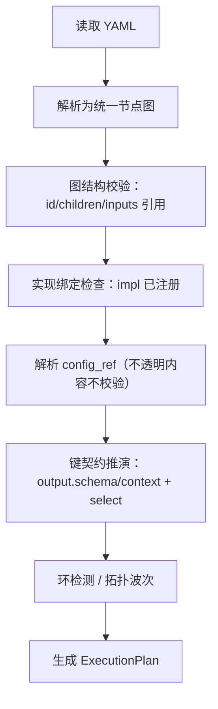

# 03 · 配置驱动 DSL 设计（统一数据流 DAG 表述）

> 所属项目：可配置化超大文件数据解析服务
> 文档类型：模块详细设计（配置驱动 DSL）
> 上游依据：[01-总体设计.md](01-总体设计.md)、[02-数据模型与核心抽象.md](02-数据模型与核心抽象.md)
> 下游关联：[04-递归分块解析引擎.md](04-递归分块解析引擎.md)、[05-算子执行模型.md](05-算子执行模型.md)

本文档定义配置驱动 DSL。**DSL 是类型无关的数据流编排描述**：它不枚举解析器/算子的具体类型、不内联其特有配置；它只定义统一节点的 DAG 表述，用于从配置推断数据流链路，并为解析器/算子的组装实例化与计算规划提供支持。

---

## 1. 设计定位：DSL 只描述数据流，不描述实现

### 1.1 核心原则

1. **类型无关**：DSL 不出现"regex/csv/kv/enrich/aggregate…"这类具体类型枚举，也不包含 delimiter/pattern/group_by 等特有配置。
2. **统一节点图**：DSL 只描述节点、节点间的结构关系与数据流关系、每个节点的输入输出契约，以及节点到实现的**绑定**。
3. **为实例化与规划服务**：DSL 编译产物告诉框架"有哪些节点、如何连接、每个节点用哪个实现、传入什么不透明配置"，但不解释实现本身。

### 1.2 分层职责边界

| 关注点 | DSL 编排层 | 实现注册中心 / 实现层（04、05） |
| --- | --- | --- |
| 节点拓扑、数据流链路 | 负责 | — |
| 输入/输出键契约 | 负责**声明** | 负责**遵循并校验实际产出** |
| 具体类型 | 仅以 `impl` id **绑定**，不解释含义 | 注册并实现 |
| 特有配置 | 以不透明 `config`/`config_ref` **透传**，不解析 | 解析并按自身 schema 校验 |
| 计算/解析逻辑 | 不涉及 | 负责 |

> 收益：新增一种解析器或算子，只需在实现注册中心注册一个新 `impl`，**DSL 语法与校验零改动**（开闭原则）；DSL 不会因实现类型增多而膨胀。

---

## 2. 配置文件结构（类型无关）

配置采用 **YAML**，顶层字段：

| 字段 | 说明 |
| --- | --- |
| meta | 元信息：配置版本、描述 |
| input | 数据源：文件路径、编码；根节点与文件名节点的绑定 |
| nodes | **统一节点图（核心）**：container/source/process 节点及其关系 |
| configs（可选） | 外置的**实现配置片段**，供节点用 `config_ref` 引用复用（内容对 DSL 不透明） |
| runtime（可选） | 运行参数：内存、并行度、输出目标等；框架持有或透传，运行时语义见 07/08 |

> 旧字段到新结构的映射见 §8；完整示例见 [11-附录.md](../references/11-附录.md)。

---

## 3. 统一节点模型

DSL 中一切节点用同一套字段描述，节点的"拓扑角色"由 `kind` 表达（这是链路语义，不是实现类型）。

| 字段 | 适用 | 说明 |
| --- | --- | --- |
| id | 全部 | 节点唯一标识，供引用 |
| kind | 全部 | 拓扑角色：`container` / `source` / `process` |
| impl | 全部 | **实现绑定 id**：指向实现注册中心中的具体实现；DSL 不解释其含义 |
| config | 全部 | 实现特有配置：**不透明对象，原样透传**给实现实例；DSL 不解析、不校验内部 |
| config_ref | 全部 | 引用顶层 `configs` 中的片段（可与少量内联 config 合并）；引用内容仍不透明 |
| children | container | 子节点（内联或 id 列表）→ **结构边** |
| inputs | process | 输入引用列表 `[{from, select}]` → **数据流边**；source 无 inputs |
| output | source/process | 输出契约：`namespace` + `schema`（见 §5） |
| context | container | 块实例身份契约：声明注入上下文的 id 字段（见 §5.3） |

### 3.1 kind 语义

| kind | 职责 | 产物 |
| --- | --- | --- |
| container | 结构节点：运行时把父区域解析为子块实例、解析实例身份并建立上下文；不产出业务 KV | 子块（结构）+ 上下文 |
| source | 叶子解析节点：数据源头，把块内容解析为 KVSet | output 契约声明的 KVSet |
| process | 算子节点：消费 inputs，产出衍生 KVSet | 衍生 KVSet |

> container/source 对应 04 的解析器树，process 对应 05 的算子；它们具体由哪个实现承担，由 `impl` 决定，DSL 不写死。

---

## 4. 两类关系与数据流链路推断

节点间存在两类边，DSL 编译器据此推断完整链路：

| 边类型 | 来源 | 语义 |
| --- | --- | --- |
| 结构边 | container 的 `children` | 块的包含/层级关系（文件→块→子块） |
| 数据流边 | process 的 `inputs[].from` | 数据依赖（节点产出被哪个算子消费） |

### 4.1 链路推断规则

1. 展开 `children` 得到结构树，确定块实例的嵌套域。
2. 由每个 process 的 `inputs[].from` 建立数据流有向边。
3. 合并为统一执行图：source 为数据起点（SourceNode），process 为衍生节点（ProcessNode）；container 提供实例域与上下文，本身不进入算子数据流。
4. 在统一图上做环检测、拓扑排序与波次划分（调度语义见 06）。

### 4.2 链路推断图

```mermaid
flowchart LR
    subgraph 结构（children）
      C[container] --> S1[source]
      C --> S2[source]
    end
    S1 --> P1[process]
    S2 --> P1
    P1 --> P2[process]
```

> 实线结构边表达"块包含叶子"，数据流边表达"算子消费节点产出"；两图合并即完整链路。

---

## 5. 输入/输出契约（键空间，类型无关）

### 5.1 输出契约 output

| 成员 | 说明 |
| --- | --- |
| namespace | 输出键的命名空间前缀（等价原 output_prefix，规范化以 `.` 结尾） |
| schema | 字段声明列表（字段名，可选值类型）；**节点输出数据键的权威集合** |

> 键空间的统一规则：**output.schema 是权威**，它有两个来源——①作者显式声明；②当注册实现能静态自描述时（如命名组、定宽字段），由 KeyDeducer 经注册中心向该实现请求默认 schema 填充。框架自身始终类型无关（只问实现、不解析格式）。对无法自描述的动态实现（键名藏在数据里），schema 必须显式声明（即实现 config 中的 key_schema.fields，配合 on_unknown）。
> 因此"静态解析器自动枚举字段"与"键必须在 schema 中"并不矛盾：前者是实现为 schema 提供默认值，后者是最终被下游引用的键一律落在 schema 内。实现运行时产出由基类按该契约校验或裁剪。

### 5.2 输入选择器 select

| 选择器 | 配置 | 说明 |
| --- | --- | --- |
| 精确键 | `select.keys: [...]` | 只取列出的键（最省内存） |
| 前缀 | `select.key_prefix: "..."` | 取以该前缀开头的键 |
| 正则 | `select.key_pattern: "..."` | 取匹配正则的键 |
| 全量 | `select.all: true` | 取全部输出（仅小数据） |

### 5.3 上下文契约 context（container）

- container 用 `context` 声明块实例的身份字段（字段名 + 可选来源，但**来源实现细节属于 impl 的 config，不进 DSL**）。
- 该字段在运行时注入为上下文键，供后代节点与算子引用，作为跨块实例 join/group 的身份。
- 未声明 context 的 container 不向后代注入身份字段。

### 5.4 键可推演规则

1. 下游**精确键**引用合法，当且仅当该键出现在被引用节点的 `output.schema`，或出现在其所属 container 的 `context` 声明中。
2. `key_prefix` 必须等于被引用节点的 namespace（或某上下文命名空间）。
3. 同节点输出键必须唯一；多输入汇聚到同一 process 产生同名字段时，须由实现配置显式消歧（否则报键碰撞）。

> 键契约的成键实现与 KeyComposer 见 [键生成规则与数据约束.md](键生成规则与数据约束.md)；本文档只定义 DSL 侧的声明形态。

---

## 6. 实现绑定与配置外置

### 6.1 impl 绑定

- 每个节点的 `impl` 必须能在实现注册中心解析到一个实现（DSL 校验"已注册"）。
- DSL 不校验该实现的内部逻辑，也不感知它是哪类解析器/算子。

### 6.2 config 不透明透传与 config_ref

| 方式 | 语义 |
| --- | --- |
| config | 不透明配置对象，编译期原样保留，实例化时原样注入；DSL 不解析其字段 |
| config_ref | 引用顶层 `configs` 片段以复用；可与内联 config 做浅合并（内联优先），但合并结果对 DSL 仍不透明 |

> `configs`/`config_ref` 取代旧的 `templates/ref`：templates 旧形态混合了"DSL 结构片段"与"实现配置"，新结构只保留"实现配置片段"的复用，且 DSL 不解释其内容。

### 6.3 组装实例化（Assembler）

1. 框架遍历执行图，对每个节点按 `impl` 向注册中心请求实现实例。
2. 将该节点的不透明 config（含 config_ref 解析结果）原样注入实现。
3. 按数据流边连接输入/输出端口，按结构边建立块实例与上下文关系。
4. 计算规划：拓扑波次、并行度、投影集合（依据 output.schema 与 select）。

### 6.4 校验职责划分

| DSL 校验（GraphValidator） | 实现注册中心 / 实现校验 |
| --- | --- |
| 图结构完整、id 唯一、children/inputs 引用存在 | `impl` 是否已注册 |
| 数据流环检测 | 特有 config 的 schema 校验（不透明内容） |
| 键契约一致性、键碰撞、前缀匹配 | 运行时产出是否符合 output 契约 |

---

## 7. 运行与输出参数（runtime）

`runtime` 段承载内存上限、队列/spill 阈值、并行度、存储介质、输出目标与格式等。DSL 仅解析并持有/透传这些框架级参数，不做与实现类型相关的解释；其运行时语义分别见 [07-大文件内存管理.md](07-大文件内存管理.md)、[08-执行流程详解.md](08-执行流程详解.md)。

---

## 8. 旧配置形态 → 统一节点图映射

| 旧形态 | 新形态 |
| --- | --- |
| `file_formatter`（递归 formatter） | `nodes` 中的 container/source 节点（结构由 children 表达） |
| `boundary.type` + marker/next_marker/length 等 | container 节点的 `impl`（分块实现绑定）+ 特有配置进 `config` |
| `block_id`（source/pattern…） | container 的 `context` 身份契约；解析实现细节进该 impl 的 config |
| 叶子 `parser.type` + delimiter/pattern/fields… | source 节点的 `impl` + 特有配置进 `config`；输出键进 output.schema |
| `dispatch_mode` | container 的 `impl`/config（调度策略由实现承担） |
| `operators`（type/inputs/config…） | process 节点：`impl` + inputs（数据流边）+ output 契约；特有计算配置进 config |
| `templates` + `ref` | `configs` + `config_ref`（实现配置片段复用） |
| `memory` / `output` | `runtime` |

---

## 9. 配置加载与编译产物

### 9.1 加载编译流程



### 9.2 ExecutionPlan（编译产物）

| 成员 | 说明 |
| --- | --- |
| graph | 统一执行图：结构边 + 数据流边、节点 kind |
| bindings | 每节点 impl 绑定 |
| opaque_configs | 每节点不透明 config（含 config_ref 解析结果） |
| key_schemas | 每节点输出/上下文键契约 |
| waves | 拓扑波次、可并行集合（供调度） |
| runtime | 透传的运行参数 |

> ExecutionPlan 是 Assembler 实例化与计算规划的唯一输入；本迭代（迭代 1）只生成该描述性产物，不执行文件解析。

---

## 10. 相关文档

- 总体设计（分层与数据流）：[01-总体设计.md](01-总体设计.md)
- 数据模型（KV/节点抽象）：[02-数据模型与核心抽象.md](02-数据模型与核心抽象.md)
- 解析器实现（container/source 实现树）：[04-递归分块解析引擎.md](04-递归分块解析引擎.md)
- 算子实现（process 实现）：[05-算子执行模型.md](05-算子执行模型.md)
- 键成键实现与推演：[键生成规则与数据约束.md](键生成规则与数据约束.md)
- 完整配置示例：[11-附录.md](../references/11-附录.md)
