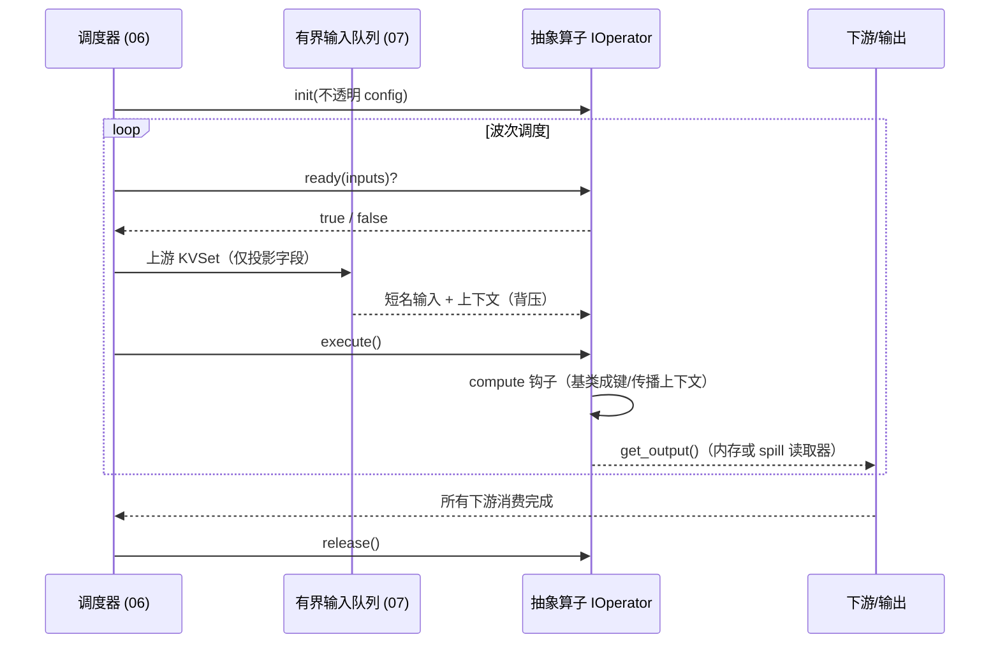

# 05 · 算子执行模型（核心抽象）

> 所属项目：可配置化超大文件数据解析服务
> 文档类型：模块详细设计（算子执行模型 · 核心框架）
> 上游依据：[01-总体设计.md](01-总体设计.md)、[02-数据模型与核心抽象.md](02-数据模型与核心抽象.md)、[03-配置驱动DSL设计.md](03-配置驱动DSL设计.md)、[04-递归分块解析引擎.md](04-递归分块解析引擎.md)
> 下游关联：[06-依赖分析与并行调度.md](06-依赖分析与并行调度.md)、[07-大文件内存管理.md](07-大文件内存管理.md)
> **边界声明**：本文只定义**抽象算子接口、BaseOperator 模板方法、输入选择与输出契约、引擎如何执行一个抽象算子**，不描述任何具体算子。具体算子（关联/聚合/转换/过滤/连接/去重等）的 impl id、不透明配置与输出字段见 [11-内置解析器与算子实现.md](11-内置解析器与算子实现.md)。

---

## 1. 模块定位与上下游

算子是数据流图中 kind=process 的节点，代表"消费上游 KV、产出衍生 KV"的一个处理步骤。本模块定义算子的**统一抽象与执行机制**，使调度器、内存管理只依赖抽象算子，而与具体计算逻辑解耦。

| 方向 | 模块 | 关系 |
| --- | --- | --- |
| 上游 | 04 解析引擎 | 叶子解析器产出的源 KVSet 是算子的最初输入 |
| 上游 | 03 配置 DSL | process 节点经 `impl` 绑定算子实现，inputs 声明数据依赖与选择器，output 声明产出契约 |
| 下游 | 06 调度 | 调度器按抽象算子生命周期与波次驱动执行 |
| 横切 | 07 内存管理 | 输入/输出经有界队列传递，超阈值统一 spill |
| 横切 | 键生成规则 | 去前缀、短名还原、成键、上下文传播由 KeyComposer 与基类统一完成 |

**装配关系**：Assembler 按 process 节点 `impl` 向 ImplementationRegistry 请求算子实例，注入不透明 config。框架与调度器只持有抽象算子类型，不引用具体算子类。

---

## 2. 抽象算子接口：IOperator

调度器只依赖该接口。它定义算子从创建到释放的生命周期：

| 方法 | 契约 | 调用时机 |
| --- | --- | --- |
| init(config) | 只做初始化与参数校验，不执行 IO 或计算；资源在此预分配 | Assembler 创建实例时 |
| ready(inputs) -> bool | 纯判断、不修改状态：声明的输入是否已就绪 | 每次调度检查 |
| execute(inputs) | 执行计算，消费输入、产出输出；必须支持流式逐条消费 | 输入就绪、进入本波次时 |
| get_output() -> KVSet | 返回输出（可能在内存或 spill 文件，以读取器形式提供） | 下游请求输入时 |
| release() | 释放全部资源（内存、spill、句柄），必须幂等 | 输出被所有下游消费后 |

---

## 3. BaseOperator 模板方法与 compute 钩子

`BaseOperator` 实现 IOperator，把与具体计算无关的动作以模板方法固化；具体算子**只实现一个 compute 钩子**。

| 成员 | 可见性 | 契约 |
| --- | --- | --- |
| init / ready / execute / get_output / release | 模板方法（final 编排） | 由基类统一实现，子类不重写 |
| compute(short_inputs, context) -> ComputeResult | **抽象钩子（子类唯一需实现）** | 输入已投影、去前缀并按短名组织；只返回输出字段短名 -> value |
| init_hook / release_hook | 可选钩子 | 子类需要的额外初始化/释放，release_hook 必须幂等 |

### 3.1 execute 模板方法固定步骤

```mermaid
flowchart TD
    A[execute(inputs)] --> B[按 inputs[].select 投影上游字段]
    B --> C[KeyComposer.to_short_name<br/>去被引用节点前缀、分离上下文键]
    C --> D[compute(short_inputs, context)<br/>子类计算，返回输出短名]
    D --> E[输出键碰撞检测]
    E --> F[KeyComposer.compose_data_key<br/>本节点 namespace + 输出短名]
    F --> G[上下文并集向下游传播]
    G --> H[组装 KVSet；超阈值由基类 spill]
```

- 算子实现者不处理投影、前缀、上下文、成键、KVSet 布局与 spill，只写"给定短名输入如何得到输出短名"。
- compute 必须流式：不得要求全量输入驻留；内部状态超阈值由基类 spill。
- 输出短名如何映射为最终字段、各算子输出字段规则，见 [11](11-内置解析器与算子实现.md) 与 [键生成规则与数据约束.md](键生成规则与数据约束.md)。

---

## 4. 算子输入：选择器抽象

算子通过输入选择器声明需要上游的**哪些输出**，而非全量引用，这是数据最小化的核心。选择器写在 process 节点 `inputs[]` 中，形如 `{from: 节点id, select: 选择器}`。

| 选择器 | 语义 | 适用 |
| --- | --- | --- |
| keys: [精确键…] | 只取列出的具体键 | 字段明确，最省内存 |
| key_prefix: 前缀 | 取所有以该前缀开头的键 | 引用某节点整组字段 |
| key_pattern: 正则 | 取匹配正则的键 | 字段按规则命名、无法逐一列举 |
| all: true | 取上游全部输出 | 仅用于小维表；大输出禁用 |

**精确键引用的合法性**：精确键只在该键已被来源节点的 output.schema（或经上下文）声明、可静态推演时合法；否则只能用 key_prefix/key_pattern/all。规则与失败码见 [键生成规则与数据约束.md](键生成规则与数据约束.md)。

**投影集合计算**：调度器在配置期汇总所有算子选择器，计算每个来源输出中被下游引用的字段集合（投影）。运行期只加载、传递投影内字段，未被引用字段在解析阶段即丢弃，不进入内存。投影下推的调度语义见 [06-依赖分析与并行调度.md](06-依赖分析与并行调度.md)。

---

## 5. 算子输出：输出契约

- 每个 process 节点用 output 契约声明产出：`namespace`（命名空间前缀，规范化以 `.` 结尾）+ `schema`（输出字段短名集合）。
- BaseOperator 按该契约统一成键：输出数据键 = `{namespace}{输出短名}`，算子建立自己的命名空间，避免与来源/其他算子冲突。
- 输出注册到节点输出端口，供下游经 inputs[].select 引用。
- 输出大小超 spill_threshold 时由基类序列化写盘，下游以读取器流式读取。
- 输出被全部下游消费后，框架调用 release（含 release_hook）立即释放。

---

## 6. 引擎如何执行一个抽象算子

本节固定调度器与抽象算子之间的交互，与具体算子无关。



执行要点：

- 调度器只面向 IOperator：就绪检查 → 喂入投影后的输入 → execute → 取输出 → 释放，全程不了解算子具体类型。
- 输入队列有界，上游产出过快时背压；算子内部状态与输出超阈值统一 spill（07）。
- 上下文随输入并集自动传播，无需算子实现处理。
- 可恢复/不可恢复错误经统一错误通道处理（09），算子不自行决定重试策略。

---

## 7. 相关文档

- 数据模型（process 节点抽象）：[02-数据模型与核心抽象.md](02-数据模型与核心抽象.md)
- 配置 DSL（inputs/output、impl 绑定）：[03-配置驱动DSL设计.md](03-配置驱动DSL设计.md)
- **具体算子实现与配置**：[11-内置解析器与算子实现.md](11-内置解析器与算子实现.md)
- 键生成、短名映射与上下文：[键生成规则与数据约束.md](键生成规则与数据约束.md)
- 调度与内存：[06-依赖分析与并行调度.md](06-依赖分析与并行调度.md)、[07-大文件内存管理.md](07-大文件内存管理.md)
