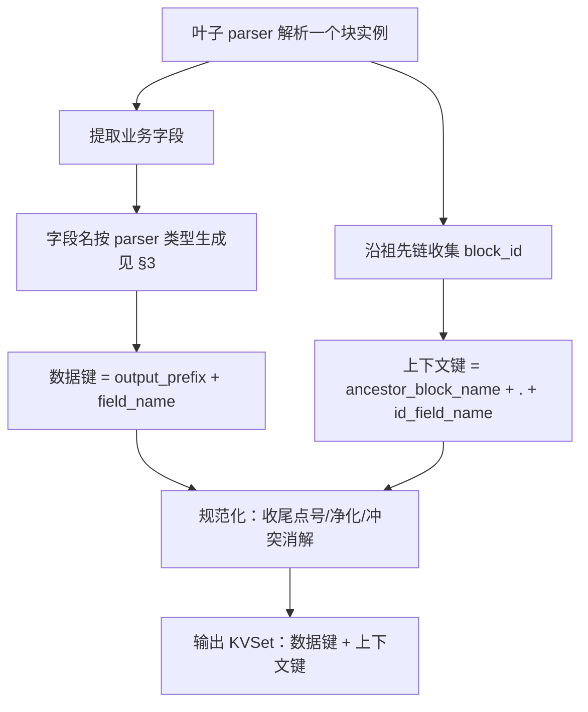
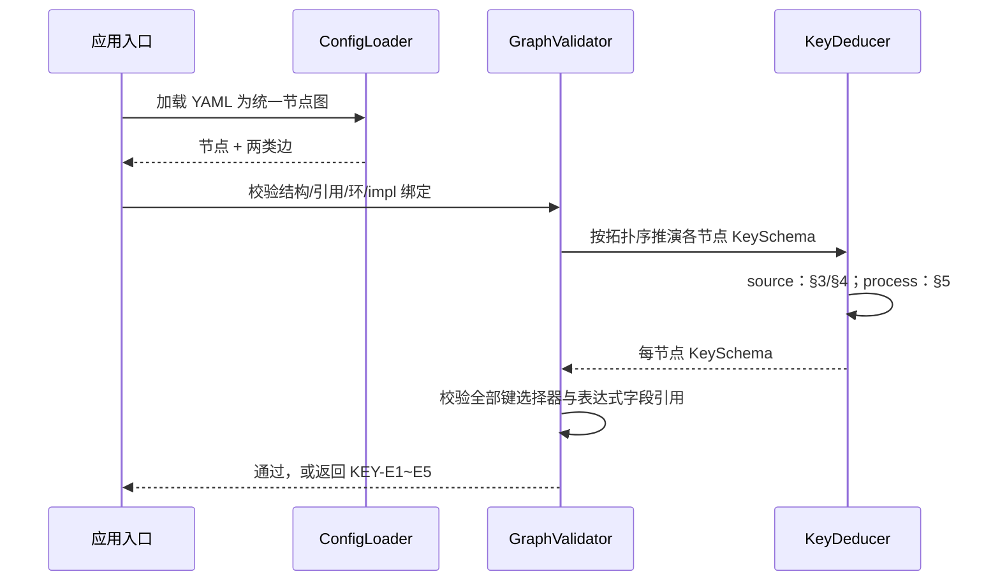

# 键生成规则与数据约束（Key 推演）

> 所属项目：可配置化超大文件数据解析服务
> 文档类型：设计类（跨切面数据约束，贯穿解析器与算子全链路）
> **文档定位：本文档是"键（Key）如何生成、如何被约束、如何被下游静态推演"的唯一权威依据。**
> 上游依据：`02-数据模型与核心抽象.md`、`03-配置驱动DSL设计.md`、`04-递归分块解析引擎.md`、`05-算子执行模型.md`。
> 说明：本文档只含规则、接口、流程图、时序图与数据推演，不含实现代码；配置片段属于数据，用于说明约束。

---

## 1. 问题与目标

### 1.1 要解决的问题

下游算子通过 `keys` / `key_prefix` / `key_pattern` 引用上游 KV。**能写出正确引用的前提，是上游产出的键能从配置静态推演出来。** 现有文档只约定了 `output_prefix`，但没有回答：

1. 前缀之后的**字段名**从哪里来？
2. 哪些解析器的字段名在配置期就确定（静态），哪些藏在数据里（动态）？
3. 对字段名来自数据的解析器（kv_pair / kv_multi / 带表头 csv / line_fields），下游如何在不知道数据的情况下推演键输入？
4. 算子输出的键如何由其类型与配置确定？

### 1.2 目标：全链路键可推演

- 给定一份配置，**不读取任何业务数据**，就能为每个节点推演出它产出的键集合（或明确的"开放集合 + 形态约束"）。
- 下游每个键引用都能在配置加载阶段被校验：存在、无歧义、无冲突。
- 运行期变化的是**值**（哪个块实例、哪一行），不是**键名**。键名静态、值动态。

### 1.3 核心结论（先给答案）

- 键分两类：**数据键（data key）**与**上下文键（context key / provenance）**。
- 寻址分两层：**字段/列名是静态的**（配置可推演，选择器与表达式引用它）；**实例/行标识是运行期值**（由上下文键与记录集承载，不写进你要引用的字段名）。
- 解析器对动态字段必须通过 `key_schema` **声明约束**，否则下游只能用前缀/正则/全量引用，不能用精确键。
- 每个算子建立自己的命名空间：数据键在算子边界被**重新加前缀**；上下文键原样传播。

> **命名映射**：本文沿用概念名 `output_prefix`（输出前缀），它在类型无关 DSL 中由节点 `output.namespace` 提供，二者是同一值；`key_schema` 等实现特有字段位于该实现的不透明 config 中，不写在 DSL 节点上。具体实现见 `11-内置解析器与算子实现.md`。

---

## 2. 键的分类与完整构成公式

### 2.1 两类键

| 类别 | 形态 | 来源 | 跨算子行为 |
| --- | --- | --- | --- |
| 数据键 data key | `{output_prefix}{field_name}` | 叶子 parser 提取的业务字段；算子衍生字段 | 每个算子用**自己的 output_prefix 重新命名空间** |
| 上下文键 context key | `{ancestor_block_name}.{id_field_name}` | 祖先容器的 block_id（块实例身份） | 保留全限定名，**原样传播**，不被重新加前缀 |

> 上下文键是"溯源/身份"字段（类似 provenance），保证任意下游都能用同一个键（如 `phase_block.phase_id`）定位记录所属的块实例，用于 join/group/关联。

### 2.2 叶子节点产出的完整键集合

一个叶子 parser 解析**一个块实例**，产出的 KVSet 包含：

1. **数据 KV**：对每个提取到的字段，键 = `{parser.output_prefix}{field_name}`。
2. **上下文 KV**：对每个（由近及远）配置了 block_id 且未设 `inherit_parent_id=false` 的祖先容器，键 = `{ancestor.block_name}.{id_field_name}`，值为该祖先解析出的块 ID。

### 2.3 规范化规则（保证确定性）

| 规则 | 说明 |
| --- | --- |
| 前缀收尾 | output_prefix 规范化为以 `.` 结尾（缺则补）；空前缀允许（键即 field_name） |
| 无空层级 | 组合后不得出现空段、首尾点号；field_name 为空时取 `field_{序号}` |
| 字段净化 | 来自数据的字段名：trim；空白与非法字符替换为 `_` |
| 冲突消解 | 同一 KVSet 内键必须唯一；碰撞时确定性追加 `__2`、`__3`… |
| 系统保留 | 以 `__` 开头的键为系统保留（如 `__filename__`、`__row__`），用户数据字段不得使用 |

### 2.4 键构成流程图



### 2.5 规则的唯一实现：KeyComposer

键规则只有**一处实现**——无状态纯函数组件 `KeyComposer`，被解析器基类、算子基类、静态推演器三方共同调用。这保证"运行时实际拼出的键"与"配置期静态推演的键"同源，不会出现推演与实现不一致。

| 操作 | 签名 | 语义 |
| --- | --- | --- |
| compose_data_key | (output_prefix, field_name) -> Key | 前缀收尾 + 字段净化 + 拼接数据键 |
| compose_context_key | (ancestor_block_name, id_field_name) -> Key | 拼接上下文键 |
| to_short_name | (key, owner_prefix) -> field_name | 去掉拥有者前缀，还原短名 |
| normalize_field | (raw) -> field_name | trim、非法字符替换、空字段名兜底 |
| dedupe | (keys) -> keys | 碰撞时确定性追加 `__2` |
| collect_context | (parse_context) -> [(context_key, value)] | 沿祖先链收集 block_id 上下文 |

> 解析器/算子的具体实现者**不直接调用字符串拼接**，也不感知上述规则；这些动作由抽象基类（§3、§5）在模板方法中统一调用 KeyComposer 完成。

---

## 3. 解析器接口与抽象基类（BaseParser）

| parser 类型 | field_name 来源 | 静态/动态 | 不读数据能否枚举字段名 |
| --- | --- | --- | --- |
| regex | 正则的**命名捕获组名** | 静态 | 能（从 pattern 的命名组） |
| fixed_width | `fields[].name` | 静态 | 能（从 fields） |
| json_path | 显式别名优先，否则取 path 末段 | 静态 | 能（从 paths） |
| csv / tsv（has_header=false） | 位置名 `col_{序号}`（从 0 起） | 静态 | 能（按位置） |
| csv / tsv（has_header=true） | **表头单元格文本**（净化后） | **动态** | 否，需 key_schema 或前缀/全量 |
| kv_pair | 数据中的**左值键名**（净化后） | **动态** | 否，需 key_schema 或前缀/全量 |
| kv_multi | 数据中的**键名 token**（净化后） | **动态** | 否，需 key_schema 或前缀/全量 |
| line_fields | 每行行首的**字段名 token** | **动态** | 否，需 key_schema 或前缀/全量 |
| custom | 插件产出 | 默认动态 | 必须在配置中**声明输出字段 schema** |

> 本表是**实现侧**的字段名来源说明，与 DSL 的 output.schema 规则一致：静态解析器能自描述，KeyDeducer 经注册中心向其请求默认字段来填充该节点 output.schema（框架不解析格式）；动态解析器无法自描述，必须在 config 中用 key_schema 声明，其 fields 即成为 output.schema。最终被下游引用的键一律落在 output.schema 内。动态解析器的 on_unknown 等约束见 §4。

### 3.1 抽象基类 BaseParser（统一成键，子类只实现提取）

所有叶子解析器继承抽象基类 `BaseParser`。基类用**模板方法**把"成键相关动作"全部固化，子类只实现一个提取钩子，不接触前缀拼接、上下文注入、净化、冲突消解、记录集展开。

> 叶子解析器的对偶是**容器解析器 `BaseContainerParser`**（结构解析：把文件/父块解析成子块、解析 block_id 并压入 ParseContext），定义在 `04-递归分块解析引擎.md` §1。上下文键链路由容器解析器压栈、叶子解析器收集。

**元信息**（由子类声明/构造传入）：`output_prefix`、`key_schema`、parser `type`。

| 成员 | 可见性 | 契约 |
| --- | --- | --- |
| parse(block, parse_context) -> KVSet | **final 模板方法，子类不可覆盖** | 按 3.2 固定步骤执行 |
| extract(block) -> ParseResult | **抽象钩子，子类唯一必须实现** | 只负责"从字节得到 field_name→value（或记录集）"；不拼键、不加前缀、不注入上下文 |
| init_hook / release_hook | 可选覆盖 | 资源的申请/释放（缺省空实现） |

**ParseResult**：字段 map（field_name→typed value）或记录集（多行，见 §6.2）。

### 3.2 parse 模板方法固定步骤

```mermaid
flowchart TD
    A[parse(block, ctx)] --> B[调用子类钩子 extract(block)<br/>得到 ParseResult]
    B --> C[套用 key_schema：<br/>字段约束 / on_unknown 处理]
    C --> D[记录集或展开 explode_records 处理 §6.2]
    D --> E[逐字段 KeyComposer.compose_data_key<br/>= output_prefix + field_name]
    E --> F[KeyComposer.collect_context(ctx)<br/>生成祖先上下文键]
    F --> G[normalize / dedupe / 系统保留校验]
    G --> H[组装并返回 KVSet（携带 output_prefix）]
```

### 3.3 具体解析器职责

| 具体 parser | 只需实现 |
| --- | --- |
| RegexParser / FixedWidthParser / JsonPathParser | extract：按命名组 / fields / paths 产出字段 map |
| PositionedCsvParser（无表头） | extract：按 col_{n} 产出字段 |
| HeaderedCsvParser / TsvParser | extract：按表头产出字段；key_schema 提供静态约束 |
| KvPairParser / KvMultiParser / LineFieldsParser | extract：产出数据中的键；key_schema 提供静态约束 |
| CustomParser | extract + 在配置中声明输出字段 schema |

> 解析引擎侧的接口说明见 `04-递归分块解析引擎.md` §5，与本契约一致。

---

## 4. 动态键的数据约束机制（key_schema）

### 4.1 约束声明

动态 parser 在其不透明 config 中通过 `key_schema` 把"开放的键空间"收敛为"可推演的键空间"。下例节点 `output.namespace="fa_kv."`、impl=`kv_multi_extract`，其不透明 config 片段：

```yaml
key_schema:
  fields: [temperature, pressure, status]   # 已知/允许字段短名
  on_unknown: keep                          # error / drop / keep
```

| 配置 | 语义 |
| --- | --- |
| `fields` | 已知字段集合，用于静态推演与精确引用校验 |
| `on_unknown: error` | 数据出现 fields 之外的键 → 配置/数据错误（严格白名单，此时键集合被完整枚举） |
| `on_unknown: drop` | 未知键直接丢弃（键集合被完整枚举为 fields） |
| `on_unknown: keep`（默认） | 未知键保留；节点为"部分开放"，精确引用只对 fields 内生效，其余需前缀/正则 |
| `pattern`（替代 fields） | 只约束字段名形态（如 `[a-z_]+`），不能枚举精确键，下游仍须前缀/正则 |

### 4.2 精确引用的合法性判定（核心规则）

> **一个精确键引用（`keys` 或表达式里的字段引用）合法，当且仅当被引用节点的"已枚举字段集合"包含该键。**

- 静态 parser：已枚举集合 = §3 规则推出的字段。
- 动态 parser：已枚举集合 = `key_schema.fields`（且要被精确引用，应配合 on_unknown=error/drop，或明确只校验 fields 内）。
- 不满足时，下游**只能**用 `key_prefix`（等于该节点 output_prefix）、`key_pattern` 或 `all`；写精确键直接校验失败。

### 4.3 数据推演 · 动态 parser 的三种下游写法

给定 kv_multi parser，output_prefix=`fa_kv.`，数据为 `temperature:36.5,pressure:101,note:ok`。

| 场景 | 配置 | 推演结果 |
| --- | --- | --- |
| 声明完整白名单 | key_schema.fields=[temperature,pressure], on_unknown=drop | 静态集合={fa_kv.temperature, fa_kv.pressure}；`note` 丢弃；下游可精确引用这两个键 |
| 部分开放 | key_schema.fields=[temperature], on_unknown=keep | 可精确引用 fa_kv.temperature；pressure/note 只能用 key_prefix=fa_kv. 获取 |
| 完全不约束 | 无 key_schema | 节点开放；下游仅允许 key_prefix=fa_kv. / key_pattern / all，禁止精确键 |

---

## 5. 算子接口与抽象基类（BaseOperator）

`05-算子执行模型.md` 定义的 Operator 五生命周期接口，由抽象基类 `BaseOperator` 以**模板方法**统一实现：与键、投影、资源相关的固定动作全部由基类完成，子类只实现一个计算钩子，不接触前缀还原、投影裁剪、上下文分离与传播、KVSet 组装。

### 5.1 抽象基类 BaseOperator 契约

| 成员 | 可见性 | 契约 |
| --- | --- | --- |
| init(config) | 模板方法 | 解析 output_prefix 与 inputs 选择器，再调用可选 init_hook |
| ready(inputs) | 基类实现 | 检查声明输入是否就绪（子类不覆盖） |
| execute(inputs) -> KVSet | **final 模板方法，子类不可覆盖** | 按 5.2 固定步骤执行 |
| compute(short_inputs, context) -> ComputeResult | **抽象钩子，子类唯一必须实现的核心方法** | 输入为已投影、已去前缀、按短名组织的数据；只返回输出字段短名→value（或记录集）；不碰前缀/上下文/KVSet |
| get_output() / release() | 基类实现 | 输出端口管理、资源与 spill 释放；release 前调用可选 release_hook |

**ComputeResult**：输出字段 map（out_field_short_name→typed value）或记录集。

### 5.2 execute 模板方法固定步骤

```mermaid
flowchart TD
    A[execute(inputs)] --> B[按 key 选择器对各输入做投影<br/>只保留被引用字段]
    B --> C[逐输入 KeyComposer.to_short_name<br/>去前缀还原短名；分离上下文键]
    C --> D[调用子类钩子 compute(short_inputs, context)]
    D --> E[输出字段碰撞检测 KEY-E4]
    E --> F[KeyComposer.compose_data_key<br/>= 本算子 output_prefix + 输出短名]
    F --> G[上下文键取并集，原样传播]
    G --> H[normalize / dedupe，组装 KVSet]
```

### 5.3 统一规则：算子建立新命名空间

- **数据键**：算子输出的全部数据 KV 都挂在**自己的 output_prefix** 下；后缀由"短名（short name）"经各类型规则映射得到。
  - 短名 = 输入键去掉**被引用节点自身前缀**后的字段名（formatter 输入去 parser.output_prefix；算子输入去该算子 output_prefix）。
- **上下文键**：默认把各输入的上下文键取并集、**原样传播**；如需改名须显式配置。

### 5.4 各算子类型的输出字段规则

| 算子 | 输出数据字段（output_prefix 下的后缀） | 静态可枚举条件 |
| --- | --- | --- |
| filter | 投影输入字段的短名（透传） | 输入已枚举 |
| deduplicate | 投影输入字段的短名（透传） | 输入已枚举 |
| transform | 重命名/表达式配置中声明的名字（`as`/映射）；未声明字段默认丢弃 | 配置显式给出 |
| enrich | 主流投影字段短名 + 关联维表字段的别名（见 5.5） | 输入已枚举且别名无碰撞 |
| join | 显式 select 列表；缺省用带侧别前缀的短名（如 `l_*` / `r_*`）防碰撞 | select 显式给出 |
| aggregate | 分组字段短名 + 聚合别名（`... as alias`） | group_by 与聚合别名显式给出 |
| custom | 必须在配置中声明输出字段 schema | 声明即枚举 |

### 5.5 数据推演 · enrich 输出键

给定主流 ps_csv（前缀 ps_csv.，已声明列 phase_id、test_time），维表 ps（前缀 ps.，字段 phase_id、seq）：

- 主流短名：phase_id、test_time。
- 维表关联字段：seq（phase_id 用作 join_key，不重复产出，避免碰撞）。
- enrich output_prefix=`enriched.` → 输出：`enriched.phase_id`、`enriched.test_time`、`enriched.seq`。
- 若主流与维表存在同名字段且都要输出 → **必须显式起别名**，否则校验报"输出字段碰撞"。

### 5.6 数据推演 · aggregate 输出键

给定 group_by=`enriched.phase_id`，聚合 `count(*) as csv_record_count`、`max(enriched.test_time) as latest_test_time`，output_prefix=`phase_stats.`：

- 分组字段短名 phase_id → `phase_stats.phase_id`。
- 聚合别名 → `phase_stats.csv_record_count`、`phase_stats.latest_test_time`。
- 聚合输出字段完全由配置静态确定，与数据行数无关。

---

## 6. 实例与行：两层寻址（为什么不需要把序号写进键名）

### 6.1 块实例身份 = 上下文键的值

容器（如 phase_block）会重复出现多个实例。**键名在各实例间相同，值不同**；上下文键（`phase_block.phase_id`）的值标识实例，是跨块 join/group 的依据。因此下游引用字段时不需要知道"第几个块"。

### 6.2 块内多行 = 记录集（record set）

一个 parser 在一个块内产出多条记录（csv N 行、line_fields N 行）时，按两种方式表示，均不把运行期序号塞进你引用的字段名：

| 方式 | 表示 | 引用方式 |
| --- | --- | --- |
| 记录集（默认） | 以 array/block_ref 承载的"表"，列名静态 | enrich/aggregate/join 等面向集合的算子，在 join_key/group_by/聚合中直接写**列短名**（如 `ps_csv.phase_id`），运行期按记录迭代 |
| 展开（explode_records=true） | 每行加保留索引段：`{output_prefix}{row_index}.{column}` | 形态静态、行数动态；行号以保留字段 `__row__` 表示 |

> 关键：下游表达式引用的是**静态列名**，运行期用上下文键（块实例）与记录集（行）完成关联。这正是"不读数据也能推演键输入"的落点。

---

## 7. 静态键推演算法（配置 → 每节点 KeySchema）

### 7.1 节点 KeySchema 结构

| 成员 | 说明 |
| --- | --- |
| data_fields | 已枚举的数据字段短名集合（或 OPEN 标记 + prefix/pattern） |
| context_keys | 上下文键集合（祖先 block_id 链） |
| fully_enumerated | 是否完整枚举（决定精确引用能否校验） |

### 7.2 推演流程（按拓扑序）

```mermaid
flowchart TD
    A[按拓扑序取节点] --> B{SourceNode 叶子?}
    B -- 是 --> C[按 §3 生成字段集合]
    C --> D{动态 parser?}
    D -- 是 --> E[套用 key_schema：<br/>fields→枚举 / pattern 或无→OPEN]
    D -- 否 --> F[字段已枚举]
    B -- 否（算子） --> G[对投影输入求短名]
    G --> H[按 §5 类型规则生成输出字段]
    H --> I{输入全枚举且映射显式?}
    I -- 是 --> J[算子输出可枚举]
    I -- 否 --> K[算子输出 OPEN(output_prefix)]
    E --> L[汇总 context_keys=祖先链]
    F --> L
    J --> M[汇总 context_keys=输入并集]
    K --> M
    L --> N[得到节点 KeySchema]
    M --> N
    N --> O[校验该节点下游的全部键引用]
```

### 7.3 引用校验与失败码（纳入 SchemaValidator）

| 失败码 | 触发条件 |
| --- | --- |
| KEY-E1 精确键不存在 | `keys`/表达式字段不在被引用节点的已枚举集合 |
| KEY-E2 前缀不匹配 | key_prefix 不等于该节点 output_prefix 或任一上下文命名空间 |
| KEY-E3 节点内键重复 | 同节点枚举结果出现重复键（净化/冲突消解后仍碰撞） |
| KEY-E4 算子输出碰撞 | 多个输入短名相同且未显式别名 |
| KEY-E5 开放源被精确引用 | 对 OPEN 节点写精确键，或表达式引用未声明列 |

### 7.4 时序图 · 配置加载中的键推演



---

## 8. 端到端数据推演（以附录完整示例为准）

对 `../references/11-附录.md` 的示例逐节点推演（不读数据）：

| 节点 | 类型/前缀 | 推演的数据键 | 上下文键 | 可枚举性 |
| --- | --- | --- | --- | --- |
| __filename__ | regex / file. | file.date | — | 可枚举 |
| ps_meta | regex / ps. | ps.phase_id、ps.seq、ps.batch | phase_block.phase_id | 可枚举 |
| fa_meta | regex / fa. | fa.field_names、fa.indices | phase_block.phase_id | 可枚举 |
| ps_csv | csv 有表头 / ps_csv. | **动态：表头列** | phase_block.phase_id | 默认 OPEN |
| fa_kv | kv_multi / fa_kv. | **动态：数据键名** | phase_block.phase_id | OPEN |
| enrich_csv_with_fa | enrich / enriched. | enriched.phase_id、enriched.test_time、enriched.seq | phase_block.phase_id | 依赖 ps_csv 列被声明 |
| aggregate_phase | aggregate / phase_stats. | phase_stats.phase_id、phase_stats.csv_record_count、phase_stats.latest_test_time | phase_block.phase_id | 可枚举 |

**推演中发现的真实缺口**：ps_csv 配置为 `has_header: true`（列名来自表头，OPEN）。enrich 用 `key_prefix: ps_csv.` 引用（对 OPEN 合法），但其 `join_key: ps_csv.phase_id = ps.phase_id` 以及下游用到的 `enriched.test_time` **按名引用了具体列**。按 §4.2，对 OPEN 源的精确列引用无法静态验证 → 触发 KEY-E5。

**修复（使全链路可静态推演）**：ps_csv 节点 `output.namespace="ps_csv."`、impl=`csv_extract`，在其不透明 config 中声明已知列：

```yaml
key_schema:
  fields: [phase_id, test_time]   # 表头至少包含这些被引用列
  on_unknown: keep
```

修复后：ps_csv 已枚举字段含 phase_id、test_time → enrich 输出可枚举（enriched.phase_id、enriched.test_time、enriched.seq）→ aggregate 的 group_by/聚合引用全部可验证。fa_kv 保持 OPEN，aggregate 以 key_prefix=fa_kv. 引用，合法。

**推演结论**：全链路每个精确键引用都能在配置期定位到某个节点的已枚举字段；前缀引用都匹配对应 output_prefix；无歧义无碰撞。

---

## 9. 与既有文档的关系与同步规则

| 文档 | 关系 |
| --- | --- |
| `02-数据模型与核心抽象.md` | 键的结构定义在 02；本文档定义键的**生成与约束**，二者互补 |
| `03-配置驱动DSL设计.md` | parser/算子配置新增 `key_schema`、输出字段映射，以本文档为语义依据 |
| `04-递归分块解析引擎.md` | 叶子 KV 提取、父块 ID 注入的键命名，以本文档 §2/§3/§6 为准 |
| `05-算子执行模型.md` | 算子输出键、短名映射以本文档 §5 为准 |
| `../iterators/迭代1详细设计-工程骨架数据契约与配置DSL.md` | SchemaValidator 增加键可推演性校验（KEY-E1~E5），引用本文档 |
| `../references/11-附录.md` | 完整示例须满足本文档约束（ps_csv 已补 key_schema） |
| `../references/99-自洽性校验报告.md` | 本文档纳入校验范围 |

**同步规则**：任何 parser/算子的字段名规则、key_schema 语义、短名映射、失败码的变更，必须同步更新本文档与对应模块文档，并重新做端到端键推演。
