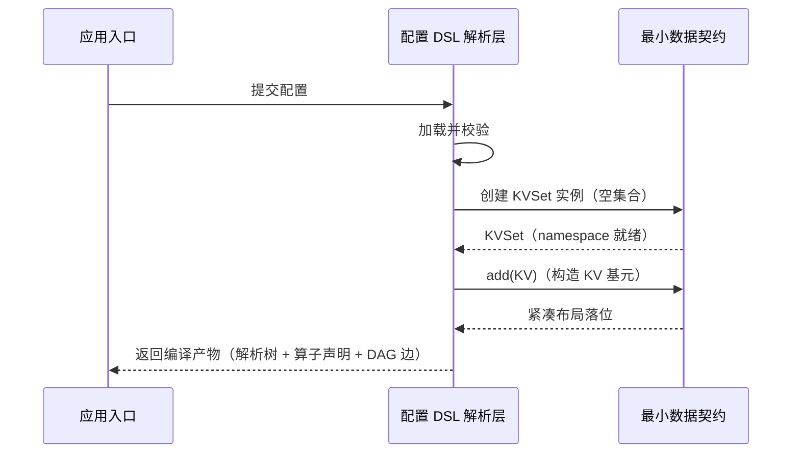
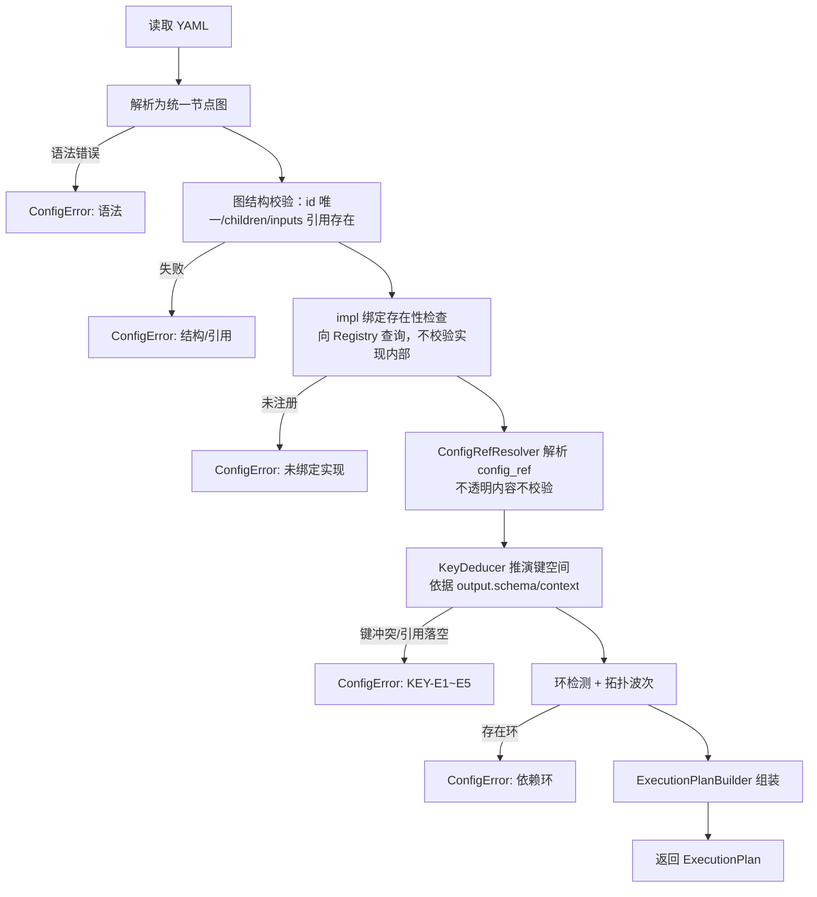
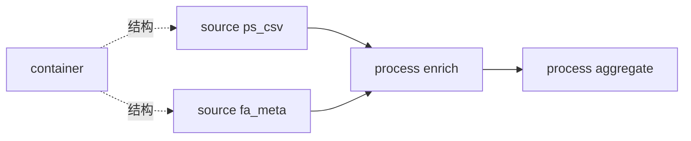
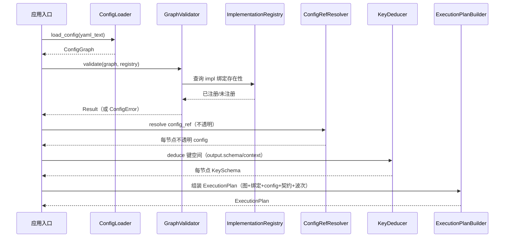

# 迭代 1 详细设计：工程骨架、最小数据契约与配置 DSL 解析层

> 所属项目：可配置化超大文件数据解析服务
> 文档类型：设计类（迭代 1 功能详细设计）
> **文档定位：本文档是迭代 1 编码的唯一权威依据**。凡涉及本迭代范围（工程骨架、最小数据契约、配置 DSL 解析层）的实现，均以本文档为准。
> 上游依据：`../design/01-总体设计.md`、`../design/02-数据模型与核心抽象.md`、`../design/03-配置驱动DSL设计.md`；本迭代规划见 `整体迭代计划.md`（迭代 1）。
> 说明：本文档只含**接口定义、逻辑说明、时序图、流程图、数据推演**，不含示例代码。

---

## 1. 文档定位与范围

**权威性**：本文档取代架构级文档（`02`、`03`）中与本迭代范围重叠部分的模糊地带，作为实现与验收的直接依据。架构级文档描述"是什么"（概念与设计意图），本文档描述"怎么实现"（接口、逻辑、流转）。二者口径一致；若出现粒度冲突，以本文档为准（本迭代范围内）。

**范围**（合并后的迭代 1）：

1. 工程骨架：项目结构、构建/依赖/测试/CI 约定、错误类型与日志基础。
2. 最小数据契约：KV / KVSet / KVRef / Block / BlockMeta / 虚拟 Block 的接口契约。
3. 配置图编译层：YAML 加载为类型无关统一节点图、GraphValidator（结构/引用/环/impl 绑定/键契约）、config/config_ref 不透明解析、KeyDeducer（output.schema/context 推演）、ExecutionPlan 生成。

> 本迭代只实现**核心框架的图编译**，不实现任何具体解析器/算子（它们是注册实现，见 `../design/11-内置解析器与算子实现.md`）；注册中心在本迭代只建立接口与注册/查询机制，内置实现于后续迭代注册。

**明确不在本迭代范围**：索引扫描（迭代 2）、递归解析执行（迭代 3）、算子执行（迭代 4）、调度（迭代 5）、内存/spill（迭代 6）、端到端集成（迭代 7）。本文档为这些后续迭代**预留接口契约锚点**，但不实现其逻辑。

---

## 2. 模块划分与依赖关系

本迭代交付以下模块（按依赖方向排序）：

| 模块 | 职责 | 依赖 |
| --- | --- | --- |
| 工程骨架 | 项目结构、构建/测试/CI、错误类型基类、日志/指标基础 | — |
| 最小数据契约 | KV/KVSet/KVRef、Block/BlockMeta、文件名节点的定义与基础操作 | 工程骨架 |
| 配置图编译层 | YAML 加载为统一节点图、GraphValidator、config_ref 解析、KeyDeducer、ExecutionPlan 生成 | 最小数据契约、工程骨架 |

依赖关系图：

> 约定：最小数据契约只定义"数据长什么样、怎么创建/访问"，不定义"如何生产/消费"（生产由解析层、消费由算子层在后续迭代实现）。配置 DSL 解析层只负责把 YAML 编译为**可执行的结构化描述**（解析树 + 算子声明 + DAG 边），不执行任何文件解析。

---

## 3. 工程骨架设计

### 3.1 目录/包结构约定

| 区域 | 职责 | 约定 |
| --- | --- | --- |
| 核心接口 | 本迭代定义的全部接口/契约 | 放独立包，不依赖具体实现 |
| 数据契约实现 | KV/KVSet/Block 的基础实现 | 只依赖核心接口 |
| 配置解析 | DSL 加载/校验/编译 | 只依赖核心接口与数据契约 |
| 工具 | 错误类型、日志、指标、构建辅助 | 被上三者共享 |
| 测试 | 单元测试 | 与源码同构，单测覆盖每个模块 |

### 3.2 构建 / 依赖 / 测试 / CI 约定

- 构建：统一语言构建工具，输出可重复构建（锁定依赖版本）。
- 依赖：最小化外部依赖；解析/核心路径不引入重量级运行时依赖。
- 测试：单元测试为必须；本迭代要求数据契约与配置解析两层均有测试。
- CI：提交触发构建 + 全量单测；失败阻断合并。

### 3.3 错误类型体系（本迭代）

| 错误类别 | 语义 | 处理策略 |
| --- | --- | --- |
| ConfigError | 配置错误（语法/语义/环/引用失效） | 启动阶段 fail-fast，报错含配置位置与原因，拒绝启动 |
| 内部契约错误 | 违反数据契约不变量（如非法 Value 类型） | 视为编程错误，快速失败并记录调用栈 |
| 后续迭代错误 | 分块/解析/算子/IO/内存等 | 本迭代仅预留分类占位，不实现（见 `../design/09-错误处理与可观测性.md`） |

> 本迭代只落地 ConfigError 与内部契约错误。错误分类总表见 `../design/09`，此处仅定义本迭代用到的部分。

### 3.4 日志与指标基础

- 日志：结构化日志，必须携带可定位上下文（配置路径、模块、阶段）。
- 指标：预留 Prometheus metrics 接入点；本迭代至少暴露"配置加载成功/失败计数、加载耗时"。

---

## 4. 最小数据契约设计

### 4.1 KV 接口契约

| 成员 | 签名/类型 | 说明 |
| --- | --- | --- |
| Key | 分层命名空间字符串，点号分隔层级（如 `user.profile.name`） | 不可变；空层级非法 |

> **键的生成规则与可推演约束**：键分**数据键**（`{namespace}{field_name}`）与**上下文键**（`{祖先节点 id}.{身份字段}`）。数据键权威集合为节点 output.schema：可由作者显式声明，或在实现能静态自描述时由 KeyDeducer 经注册中心向实现请求默认值填充；动态实现（键名藏在数据里）必须在其 config 中用 key_schema 声明。完整规则、短名映射与失败码 KEY-E1~E5 见 `../design/键生成规则与数据约束.md`。
| Value | 强类型联合：string / int64 / float64 / bool / bytes / array / map / block_ref | 基元类型集合见下表 |
| type() | -> ValueType | 返回 Value 的实际类型 |
| key() | -> Key | 返回键 |
| value() | -> TypedValue | 返回类型化值（按 type 强转） |

**Value 基元类型**（本迭代确定的最小集合）：

| 类型 | 语义 |
| --- | --- |
| string / int64 / float64 / bool / bytes | 标量基元 |
| array / map | 结构化基元 |
| block_ref | 特殊类型：Block 引用（见 4.3），不持有实际字节 |

> **演进机制**：该集合是"最小可用集"，后续迭代（parser 需要新类型、算子需要中间类型）**按需扩展**，扩展时必须：①在类型枚举增加成员；②定义其序列化表示；③同步更新 `02-数据模型与核心抽象.md`。禁止为尚未出现的需求预加类型。

### 4.2 KVSet / KVRef 契约

| 成员 | 签名/类型 | 说明 |
| --- | --- | --- |
| KVSet | KV 集合，携带来源节点 output.namespace 作为命名空间 | 节点间传递的统一数据单元；可为单 KV |
| namespace() | -> string | 来源节点命名空间（即输出前缀） |
| add(KV) / get(key) / size() | — | 基础集合操作 |
| to_refs() | -> 一组 KVRef | 生成轻量引用（offset + length），不复制数据 |
| KVRef | (offset, length) 轻量引用 | 用于堆外/磁盘表示，不持有实际数据 |

**数据推演 · KVSet 紧凑布局（为何这样设计）**：

给定 1000 万条 Block-KV，若每条 KV 以独立对象持有（对象头 + 元数据 + 引用指针），对象开销可达每条约 40~64 字节，总驻留 400~640MB。

紧凑布局将其拆为三部分：
1. **共享字符串表**：所有 Key 去重后存入一张表，每条 KV 只存 key 的索引（整数），Key 级重复立即消除。
2. **连续字节区**：所有 Value 按类型序列化后写入一块连续区域，每条 KV 只存 (offset, length)。
3. **偏移索引数组**：整数数组记录每条 KV 在字节区中的偏移，顺序即遍历顺序。

结果：每条 KV 的驻留开销降到**一个整数索引 + 一个 (offset,length) 对**（约 8~16 字节），1000 万条约 80~160MB，且 cache 友好。block_ref 类型的 Value 本就不复制字节，只存引用元数据（16~32 字节）。

> 本迭代实现紧凑布局的基础结构；具体序列化格式（proto/flatbuffers）在需要跨阶段传递或 spill（迭代 6）时按需落地。

### 4.3 Block / BlockMeta / 虚拟 Block 契约

| 成员 | 签名/类型 | 说明 |
| --- | --- | --- |
| BlockMeta | block_name、block_id、offset、size、depth、parent_block_id | 块元数据（索引扫描写入，见迭代 2） |
| Block | BlockMeta + 原始字节引用（mmap 区域 byte slice） | 零拷贝；解析器在引用上 offset 切片 |
| block_ref 值 | (offset, length, mmap 区域句柄, block_id, 祖先上下文) | 不持有实际字节 |
| 虚拟 Block | block_name 固定为 `__filename__`，内容为文件名字符串 | 参与正常递归解析流程（见 4.4） |

**数据推演 · Block 引用为何零拷贝**：

以 80GB 文件为例，若每个 Block 复制其字节，则解析过程中数据被反复复制（父块→子块→KV），IO 与内存倍增。改为 Block 只持有 mmap 区域的 (offset, length) 引用，子块切分只是把 (offset, length) 缩小，全程**不复制字节**，仅当 KV 需要跨阶段传递或 spill 时才序列化。这是"单遍优先 / 零拷贝"设计原则在数据契约层的落地。

### 4.4 虚拟 Block（`__filename__`）

文件名是一等数据源，在 DSL 中为一个 source 节点：

- 节点 id 固定为 `__filename__`，由 `input.filename_node` 绑定。
- 内容为文件名字符串。
- 与普通 source 完全相同：按 impl 绑定解析器、用 output 契约声明产出（默认 namespace 为 `file.`），特有配置在 configs 中。
- 注入时机：索引扫描阶段置于 BlockIndex 首位（本迭代只定义其数据契约，注入动作在迭代 2 实现）。

### 4.5 时序图 · 本迭代内 KV 数据流转

> 说明：本迭代 KV 仅在"配置编译产物"层面被创建用于演示/测试契约；真正由解析产出的 KV 流转在迭代 3 之后。

---

## 5. 配置 DSL 解析层设计（类型无关图编译）

> 本层是**类型无关**的：不识别解析器/算子的具体类型与特有配置，只把 YAML 编译为"统一节点图 + 实现绑定 + 键契约"的 ExecutionPlan。DSL 语义权威见 `../design/03-配置驱动DSL设计.md`。

### 5.1 模块划分与接口

| 模块 | 接口/职责 | 产出 |
| --- | --- | --- |
| ConfigLoader | 读取并解析 YAML 为统一节点图对象 | ConfigGraph（meta/input/nodes/configs/runtime） |
| GraphValidator | 类型无关校验：图结构、引用、环、impl 绑定存在性、键契约 | 校验结果或 ConfigError |
| ConfigRefResolver | 解析 config_ref，对不透明配置片段做浅合并（内联优先） | 每节点不透明 config（内容不解析） |
| KeyDeducer | 依据 output.schema/context 推演每节点键空间（不看 impl） | 每节点 KeySchema |
| ImplementationRegistry | 维护 impl id → 实现的注册；提供绑定存在性查询（本迭代不实例化） | 绑定查询结果 |
| ExecutionPlanBuilder | 组装执行计划 | ExecutionPlan |

调用入口接口（契约）：

| 成员 | 签名 | 说明 |
| --- | --- | --- |
| load_config | (yaml_text) -> ConfigGraph | 加载为统一节点图 |
| validate | (ConfigGraph, Registry) -> Result | 结构+引用+环+绑定+键契约校验 |
| compile | (ConfigGraph, Registry) -> ExecutionPlan | 生成描述性执行计划（不读文件、不实例化） |

> ExecutionPlan 结构见 5.10；完整阶段语义见 `../design/08-执行流程详解.md`。

### 5.2 统一节点图结构

顶层（类型无关）：

| 字段 | 说明 |
| --- | --- |
| meta | 版本、描述 |
| input | 数据源：路径、编码、根节点与文件名节点绑定 |
| nodes | 统一节点集合（核心） |
| configs（可选） | 外置实现配置片段，供 config_ref 引用（内容不透明） |
| runtime（可选） | 内存/并行度/输出等框架参数，持有或透传 |

节点字段：

| 字段 | 适用 | 说明 |
| --- | --- | --- |
| id / kind / impl | 全部 | 标识 / 拓扑角色（container·source·process）/ 实现绑定 id |
| config / config_ref | 全部 | 不透明实现配置，原样透传 / 引用 configs |
| children | container | 子节点 → 结构边 |
| inputs | process | `[{from, select}]` → 数据流边 |
| output | source·process | namespace + schema 输出契约 |
| context | container | 块实例身份契约 |

### 5.3 流程图 · 加载编译主流程

### 5.4 GraphValidator 校验逻辑（类型无关）

| 校验维度 | 规则 | 失败行为 |
| --- | --- | --- |
| 语法 | YAML 可解析、顶层/节点字段类型正确 | ConfigError，定位行 |
| 结构 | id 唯一；container 的 children、process 的 inputs 结构合法 | ConfigError，指明节点 |
| 引用 | children/inputs[].from 指向存在节点；source 无 inputs | ConfigError，指明引用 |
| 实现绑定 | 每节点 impl 在 Registry 已注册（不校验实现内部与 config 内容） | ConfigError，指明 impl |
| 环 | 数据流图无环（DFS） | ConfigError，指明构成环节点 |
| 键契约 | 精确键须落在上游 output.schema/context；前缀匹配 namespace；输出键无碰撞 | ConfigError，KEY-E1~E5 |

> **明确不校验**：config/config_ref 内的特有配置（delimiter/pattern/group_by 等）——它们在实例化时由具体实现按自身 schema 校验。

### 5.5 数据流链路推断

两类边：结构边（children，块包含）+ 数据流边（inputs[].from，数据依赖）。推断：

1. 展开 children 得块结构树与实例域。
2. 由 inputs 建数据流边；source 为 SourceNode，process 为 ProcessNode；container 不进算子数据流。
3. 环检测、拓扑波次。

### 5.6 键空间推演（类型无关）

- 节点输出数据键**一律** = output.namespace + output.schema 字段；上下文键来自 container 的 context 声明。
- 精确键合法 iff 该键在上游 output.schema 或可达 context 中；key_prefix 须等于上游 namespace。
- 多输入汇聚出现同名字段 → 须由实现配置显式消歧，否则报碰撞。

**数据推演 · 节点图 → 每节点键集合**（以 phase 示例，output.schema 显式声明）：

| 节点 kind | namespace | 声明的输出键（schema） | 上下文键 |
| --- | --- | --- | --- |
| source ps_meta | ps. | ps.phase_id、ps.seq、ps.batch | phase_block.phase_id |
| source fa_meta | fa. | fa.field_names、fa.indices | phase_block.phase_id |
| source ps_csv | ps_csv. | ps_csv.phase_id、ps_csv.test_time | phase_block.phase_id |
| source fa_kv | fa_kv. | （开放，仅前缀可引用） | phase_block.phase_id |
| process enrich | enriched. | enriched.phase_id、enriched.test_time、enriched.seq | phase_block.phase_id |
| process aggregate | phase_stats. | phase_stats.phase_id、phase_stats.csv_record_count、phase_stats.latest_test_time | phase_block.phase_id |

> 对比旧规则：不再按 parser 类型判定静态/动态；键是否可精确引用，只看它是否被 output.schema 声明。fa_kv 未声明 schema，故只能被 key_prefix=fa_kv. 引用。

### 5.7 config_ref 解析（不透明透传）

- config_ref 引用顶层 configs 片段；与内联 config 做**浅合并**（内联优先，未内联继承片段），只合并一层。
- 合并结果对 DSL 仍不透明，原样挂到节点，实例化时注入实现。

**数据推演 · 浅合并**：给定 configs.csv_space=`{delim:" ", header:true}`，节点 config_ref=csv_space 且内联 config=`{namespace 无关的 output 不涉及；此处为实现参数}`，则结果继承 delim/header，内联项覆盖同名——内联优先；DSL 不读取 delim/header 的含义。

### 5.8 impl 绑定与实例化规划

- 编译期：校验每节点 impl 在 Registry 可解析，记录绑定。
- 实例化（Assembler，后续迭代执行）：按 impl 创建实例 → 注入不透明 config → 按结构/数据流边连线。
- 新增解析器/算子 = Registry 注册新 impl，DSL 零改动（开闭原则）。

**数据推演 · 节点 → impl 绑定表**：ps_meta/fa_meta→`regex_extract`；ps_csv→`csv_extract`；fa_kv→`kv_extract`；phase_block→`marker_block_split`；enrich→`enrich_join`；aggregate→`group_aggregate`。（impl id 为注册中心标识，具体实现见 04/05；DSL 不解释。）

### 5.9 数据推演 · 环检测失败

若 process opA inputs.from=opB 且 opB inputs.from=opA，DFS 沿 opA→opB→opA 发现回边 → ConfigError，指明 {opA, opB}。

### 5.10 ExecutionPlan（编译产物）

| 成员 | 说明 |
| --- | --- |
| graph | 统一执行图：结构边 + 数据流边、节点 kind |
| bindings | 每节点 impl 绑定 |
| opaque_configs | 每节点不透明 config（含 config_ref 合并结果） |
| key_schemas | 每节点输出/上下文键契约 |
| waves | 拓扑波次、可并行集合 |
| runtime | 透传的运行参数 |

### 5.11 时序图 · 加载编译调用序列

---

## 6. 边界与异常约定（本迭代）

| 场景 | 行为 |
| --- | --- |
| 空配置 / 缺 nodes | ConfigError，提示必填缺失 |
| config_ref 指向不存在的 configs 片段 | ConfigError，指明引用 id |
| process inputs 引用不存在节点 | ConfigError，指明引用 |
| 节点 impl 未在注册中心注册 | ConfigError，指明节点与 impl id |
| 节点依赖环 | ConfigError，指明构成环的节点 |
| 精确键引用落空（未在 output.schema 声明） | ConfigError，返回 KEY-E1/E5 |
| 非法的 Value 类型赋值 | 内部契约错误，快速失败 |
| 后续迭代能力被提前调用（如执行解析） | 明确报"未实现"，不允许静默降级 |

---

## 7. 验收标准（对应迭代 1）

1. 工程可构建、单元测试与 CI 可运行。
2. 附录完整示例（`../references/11-附录.md`）可无错加载、校验、编译为 ExecutionPlan（节点图 + impl 绑定 + 不透明 config + 键契约 + 波次）。
3. 非法配置（语法错误、缺必填、环、失效引用、未绑定 impl、键引用落空）均能给出含位置与原因的 ConfigError。
4. config/config_ref 解析结果符合 §5 规则（内联优先、config_ref 浅合并、实现配置不透明）。
5. 最小数据契约（KV 基元、block_ref、文件名节点定义）通过单元测试；无"为未来臆测的过度建模"。

---

## 8. 与既有文档的关系与演进

| 文档 | 关系 |
| --- | --- |
| `../design/02-数据模型与核心抽象.md` | 本文档 §4 为其编码级细化；数据模型按需扩展时须双向同步 |
| `../design/03-配置驱动DSL设计.md` | 本文档 §5 为其编码级细化；DSL 取值集合以 03 为准，本文档负责实现口径 |
| `../design/09-错误处理与可观测性.md` | 本文档 §3.3 只落地配置与契约错误，其余为预留 |
| `整体迭代计划.md` | 本迭代规划与验收口径来源 |

**演进规则**：任何对本迭代范围（接口签名、取值集合、合并规则、错误语义）的变更，必须：①更新本文档；②同步更新对应的 02/03；③纳入 `../references/99-自洽性校验报告.md` 校验范围。
